# 2. Wireframes y prototipo navegable — NutriBalance

Estos wireframes describen la **versión implementada** de NutriBalance. Se reconstruyeron a partir de las pantallas actuales para documentar la estructura y el recorrido; no se presentan como bocetos hechos antes del desarrollo.

## Wireframes

| Pantalla | Objetivo | Wireframe |
|---|---|---|
| Portada | Explicar la consulta y llevar a la solicitud de turno. | [Ver portada](wireframe-portada.svg) |
| Solicitud | Pedir datos de contacto, fecha y horario; aclarar que el pedido queda pendiente. | [Ver solicitud](wireframe-solicitud.svg) |
| Panel profesional | Mostrar agenda, pacientes e historial tras iniciar sesión. | [Ver panel](wireframe-panel.svg) |

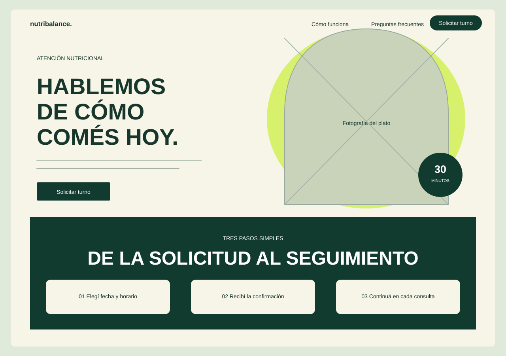

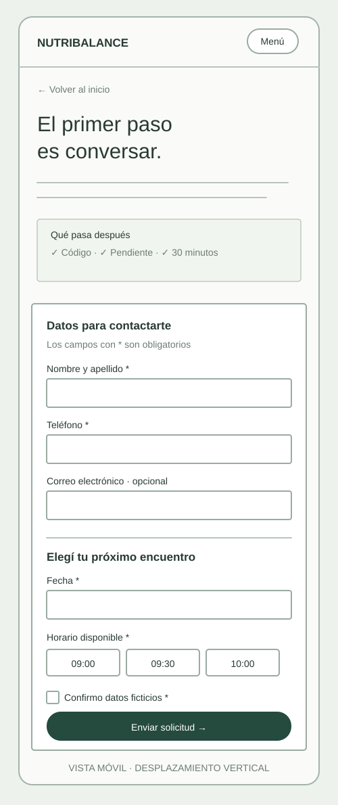

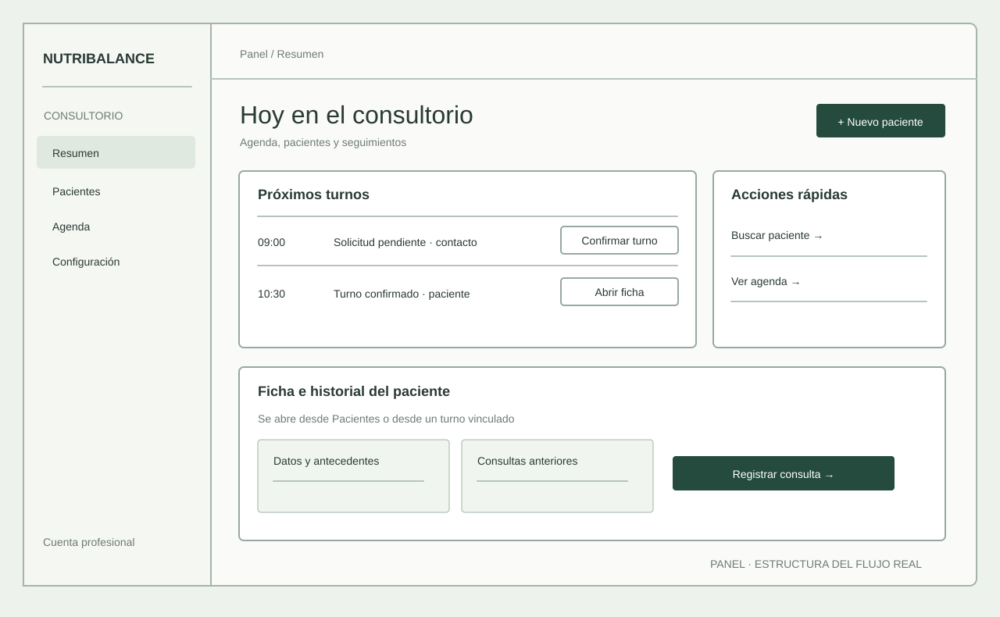

## Prototipo navegable

**URL pública:** [nutribalance-mauricio.maauri.chatgpt.site](https://nutribalance-mauricio.maauri.chatgpt.site/)

El wireframe de portada corresponde al diseño simplificado del 15 de noviembre de 2026. Las capturas se tomaron en el servidor local antes del despliegue.

| Ruta | Qué se puede recorrer |
|---|---|
| [Inicio](https://nutribalance-mauricio.maauri.chatgpt.site/) | Presentación, tres pasos, preguntas frecuentes y enlace a turnos. |
| [Solicitar turno](https://nutribalance-mauricio.maauri.chatgpt.site/solicitar-turno) | Fecha, disponibilidad, datos de contacto y envío de una solicitud pendiente. Usar sólo datos ficticios. |
| [Acceso profesional](https://nutribalance-mauricio.maauri.chatgpt.site/ingresar) | Inicio de sesión de la cuenta profesional autorizada. |
| [Panel real](https://nutribalance-mauricio.maauri.chatgpt.site/panel) | Agenda, fichas y consultas conectadas a Express; requiere sesión. |
| [Vista profesional de demostración](https://nutribalance-mauricio.maauri.chatgpt.site/demo-profesional) | Recorrido visual con datos locales de ejemplo. **No acredita persistencia en la base de datos.** |

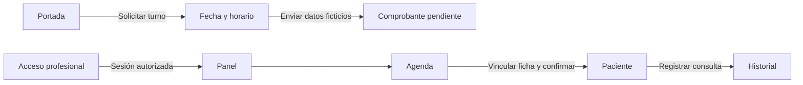

## Capturas del rediseño implementado localmente

Actualizadas el **15 de noviembre de 2026**, con el servidor local, en anchos de 1360 a 1440 y 390 píxeles.

| Pantalla | Captura |
|---|---|
| Portada en escritorio | [Abrir PNG](../evidencias/landing-redisenada-escritorio.png) |
| Portada en móvil | [Abrir PNG](../evidencias/landing-redisenada-movil.png) |
| Pasos en escritorio | [Abrir PNG](../evidencias/pasos-redisenados-escritorio.png) |
| Pasos en móvil | [Abrir PNG](../evidencias/pasos-redisenados-movil.png) |
| Preguntas frecuentes y footer en escritorio | [Abrir PNG](../evidencias/faq-footer-escritorio.png) |
| Preguntas frecuentes y footer en móvil | [Abrir PNG](../evidencias/faq-footer-movil.png) |
| Solicitud de turno en escritorio | [Abrir PNG](../evidencias/solicitar-turno-redisenado-escritorio.png) |
| Solicitud de turno en móvil | [Abrir PNG](../evidencias/solicitar-turno-redisenado-movil.png) |
| Comprobante pendiente (API simulada) | [Abrir PNG](../evidencias/solicitar-turno-comprobante.png) |

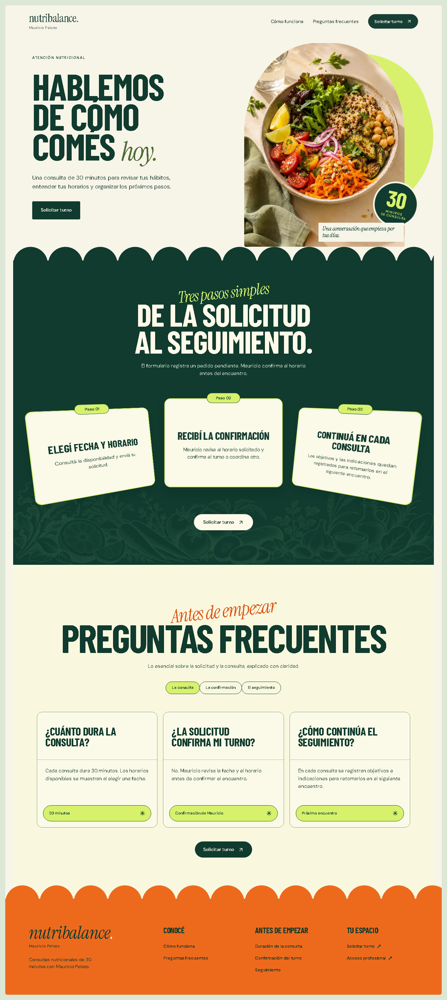

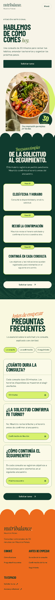

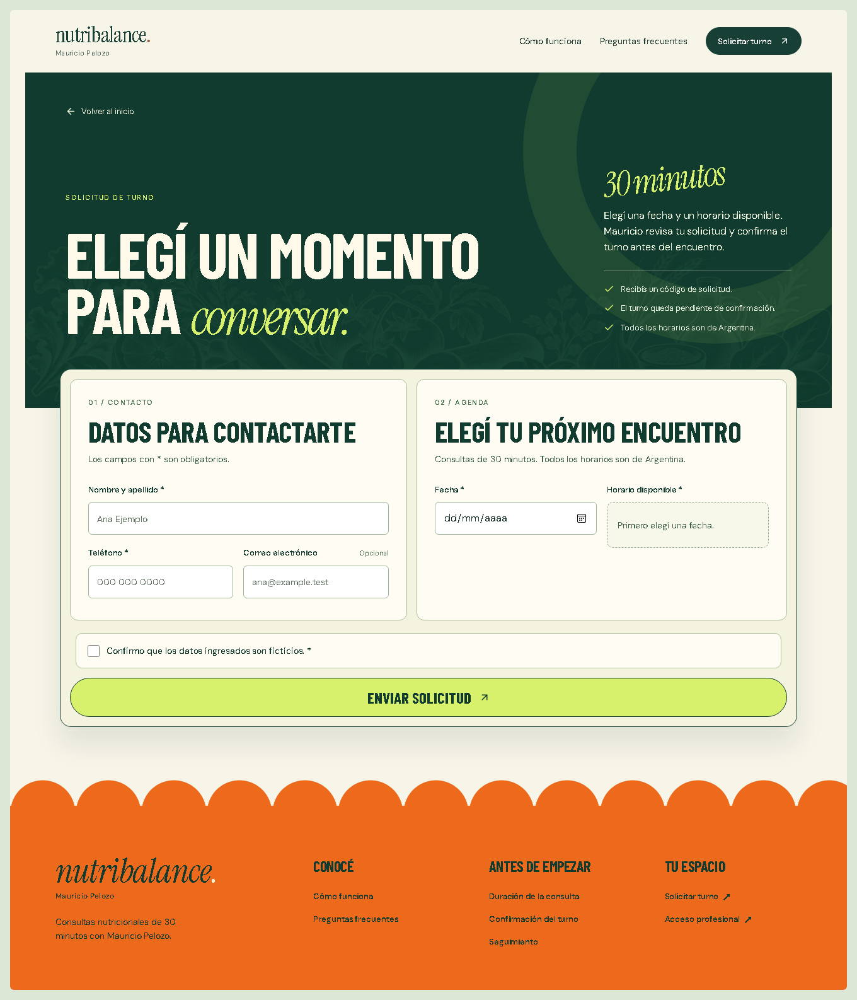

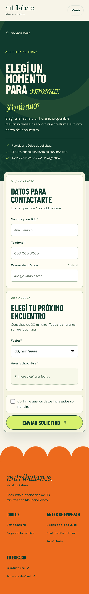

## Capturas de la versión publicada anterior

Tomadas el **11 de noviembre de 2026** en escritorio. Muestran el estado visible sin ingresar datos personales ni credenciales.

| Pantalla | Captura |
|---|---|
| Portada anterior | [Abrir PNG](../evidencias/inicio-actual-escritorio.png) |
| Formulario de turno | [Abrir PNG](../evidencias/solicitar-turno-escritorio.png) |
| Vista profesional de demostración | [Abrir PNG](../evidencias/demo-profesional-escritorio.png) |

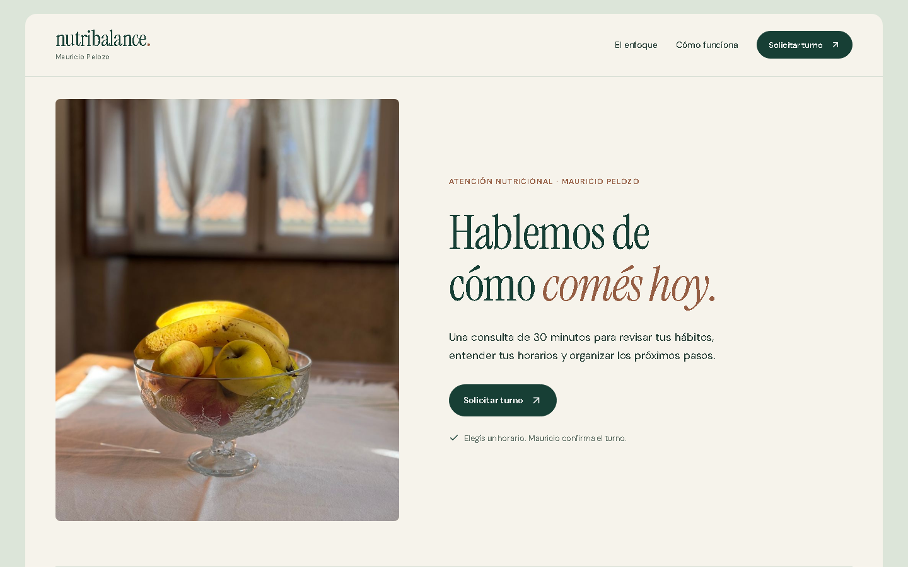

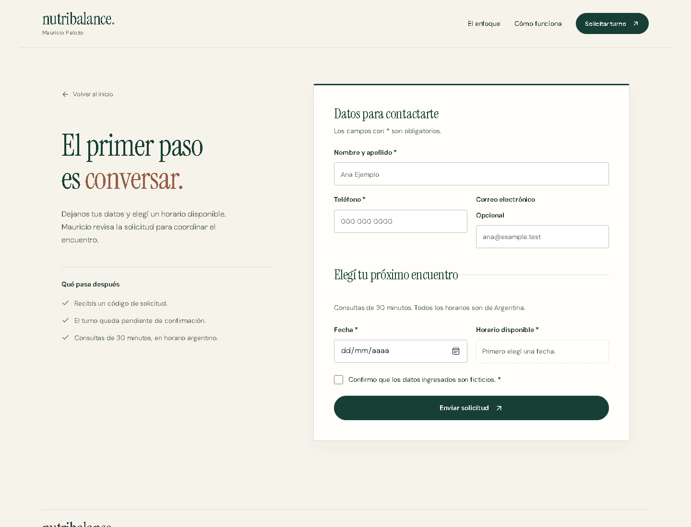

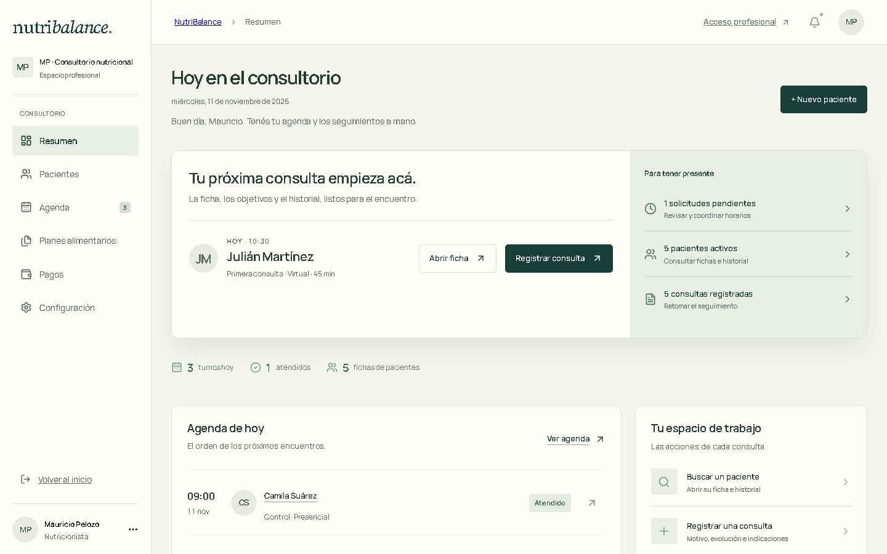

La captura de la vista profesional corresponde a `/demo-profesional`, con datos de ejemplo. El panel conectado a Express se demuestra en vivo con la cuenta del equipo, sin publicar credenciales ni datos clínicos en este documento.
