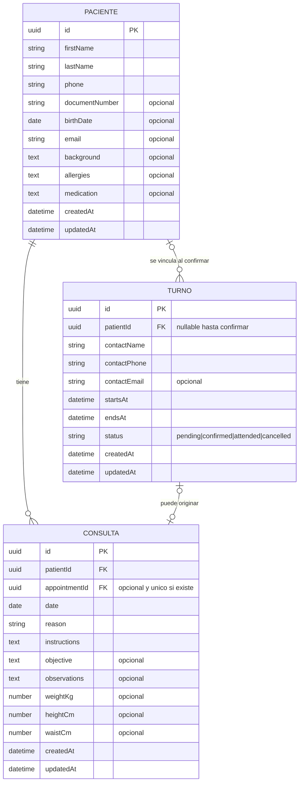

# 3. Modelo de datos lógico — NutriBalance

Este modelo representa los recursos que usa el flujo principal conectado a la **API Express**: pacientes, turnos y consultas. Se deriva del [contrato de API](../api-externa/contrato-api-frontend.md) y de [OpenAPI](../api-externa/openapi.json). **No es una copia del esquema físico de PostgreSQL**: las migraciones del backend no están en este repositorio, por lo que los nombres reales de tablas, índices y tipos SQL deben confirmarse con Bruno Cammors.

## Diagrama entidad–relación lógico

## Relaciones y reglas

| Relación | Cardinalidad y sentido |
|---|---|
| Paciente–turno | Un paciente puede tener varios turnos. Un turno pendiente puede tener `patientId = null`; al confirmarlo se vincula exactamente una ficha existente. |
| Paciente–consulta | Cada consulta pertenece a un paciente. Un paciente puede tener cero o muchas consultas. |
| Turno–consulta | Una consulta puede ser independiente (`appointmentId = null`) o vincularse a un turno. Según el contrato, un turno admite como máximo una consulta vinculada. |

La ruta pública `POST /appointment-requests` crea un **turno pendiente** con datos de contacto. El contrato no demuestra que exista una tabla independiente de “solicitudes”. Los datos de contacto del pedido no se transforman automáticamente en ficha clínica.

Los estados permitidos son `pending → confirmed` o `cancelled`, y `confirmed → attended` o `cancelled`. Confirmar exige un paciente. Una consulta vinculada exige que el turno pertenezca a ese paciente, esté confirmado, haya comenzado y coincida con la fecha de atención. Al guardarla, el backend cambia el turno a `attended` en la misma transacción, según el contrato. Una consulta independiente no cambia el turno.

`startsAt` y `endsAt` son instantes con zona en la API. La disponibilidad se muestra en `America/Argentina/Buenos_Aires` y las consultas usan una fecha local `YYYY-MM-DD`. `documentNumber` es opcional y el contrato rechaza un documento repetido; no se afirma aquí cómo se implementa esa unicidad en SQL.

## Alcance de la evidencia

La API también expone un usuario profesional y una sesión para autenticar el panel. El contrato no describe cómo se almacenan esas credenciales o sesiones, por lo que no se agregan tablas de autenticación imaginadas al diagrama. El [modelo D1 anterior](../modelo-datos.md) pertenece a un respaldo distinto y no representa esta base PostgreSQL.

Para convertir este esquema lógico en **DER físico definitivo**, el equipo backend debe adjuntar o verificar las migraciones PostgreSQL y confirmar nombres de tablas, claves foráneas, restricciones e índices reales.
